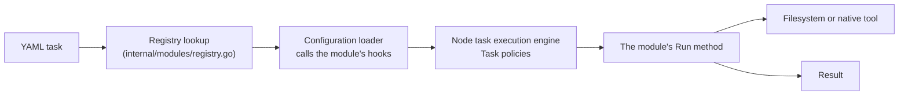

# Adding a core module to MMX

This guide is for contributors changing MMX's own code. Core modules, such
as `file`, `apt_package`, and `systemd_service`, are compiled into the node runner
executable (`mmx-runner`), so adding or changing one means changing MMX's Go
code. To give your own project a new kind of node task without changing MMX,
write a [module of the project's own](../how-to/write-your-own-module.md) instead.

## Core modules and package managers

Each core module lives in one place: one file in `internal/modules`, such as
`ufw.go`, holds its input type, the checks of its inputs, its
`mmx describe-module` description and example, the hooks the configuration
loader and the node task execution engine call, and the code that inspects
and changes the node. A registry table in `internal/modules/registry.go` lists
the core modules, one line each. The loader, `validate`, `describe-module`,
`explain`, and the engine work through the registry and the hooks, and know
no module by name. Adding a core module touches its file and one registry
line.



### Ownership

| Code | Responsibility |
|---|---|
| `internal/modules/registry.go` | The registry of core modules: each one's name, description, input type, the form a task writes it in when that differs, and its retry and timing policy (`RetryByDefault`, `WaitsWithItsOwnLimit`, `EvaluatesOnce`, `EndsTheNodeJob`, `OnlyReads`, `ChecksAConfiguration`, `KeepsOutputOfAFailure`). It also defines `Inputs`, the methods every input type has, and `NodeTask`, what the engine gives a module that runs |
| `internal/modules/<module>.go` | One module: its input type, `Prepare` (checks when the project loads, and the files it names on the controller machine), `Arguments` (the inputs that may hold a reference, with their rules), its description, `Run`, and the optional hooks below |
| `internal/modules/<module>.md` | The module's page text; `go generate ./docs/reference/modules` joins it with the description into `docs/reference/modules/<module>.md`, as the [documentation map](documentation-map.md#module-pages) says |
| `internal/modules/primitives.go` | The [primitives](design/modules.md#primitives): the `Runtime` methods through which a module reads and changes the node, which Starlark modules call under the same names |
| `internal/modules/inputs.go` | The rules every module's arguments share (`absolute`, `accountNameRule`, ...), `ArgumentList`, `FieldError`, `CopyInputs`, and `WrittenArguments` |
| `internal/modules/tracked_inputs.go` | `TrackedInput`, one input of a node task block that its services and commands follow, and the hash helpers |
| `internal/modules/controller_machine_files.go` | `ControllerFile`, a field that names a file on the controller machine, and the readers for sources, templates, and directory trees |
| `internal/config/types.go`, `timing.go` | `Task`: its settings, and the module it names (`Module`) with its inputs (`ModuleInputs`); decoding looks the name up in the registry |
| `internal/config/action.go` | `Task.ModuleCall`, `Task.CoreModule`, and the node task forms that are not modules (`role`, `task_block`, `show`, `set_vars`) |
| `internal/config/arguments.go`, `module_references.go` | Resolving and checking the arguments a module lists; reference checks of what it reads (`Reads`) |
| `internal/config/variable_sources.go`, `assets.go` | Variable source fields and frozen file assets, from the files each module lists (`ControllerFiles`) |
| `internal/config/describe.go` | `mmx describe-module`, from the registry's descriptions and the task forms' |
| `internal/engine/engine.go` | Conditions, roles, loops, secret suppression, results, and the call of each module's `Run` |
| `internal/engine/timing.go` | Shared timeout and repetition policy |
| `internal/engine/task_block.go`, `service.go`, `service_recovery.go`, `command_recovery.go` | Node task blocks: changes, validation, activation, verification, and cleanup in order; the service records and command records that follow tracked inputs |
| `internal/protocol/protocol.go`, `result.go` | Common results and their runtime values |

The optional hooks are methods an input type may have; the configuration
loader and the node task execution engine look for the optional methods:

| Hook | Used for |
|---|---|
| `CleanPaths()` | Clean resolved paths |
| `WrittenArguments()` | What `explain` shows, when it differs from the input type's fields |
| `Reads()` | Templates, conditions, and nested commands the module reads |
| `CheckSecretInputs(readsSecret, unresolved)` | Checks access to known secret content before dispatch; the loader identifies secret references and unresolved whole-value fields, and the module owns the access rule |
| `ControllerFiles()` | Sources, templates, downloads, and key files on the controller machine |
| `ExpandInventoryGroups(inventory)` | Rules with `from_inventory_group` (`ufw`, `firewalld`) |
| `CheckWithinFleetStage(record, conditional)` | Checks across the tasks of one fleet stage (package versions and dnf module streams) |
| `ResultIsSecret()` | A result that is secret whatever it reads |
| `OnlyReads()` | Uses the node task's inputs to determine whether the module only reads, even though the module can change state with other inputs |
| `ManagedPaths()` | Paths a later `path_exists` cannot check in a dryrun |
| `UnknownInADryrun(result)` | Result fields a dryrun cannot know |
| `TrackedInputs()`, `LocateOnNode()` | What a node task block's services and commands follow. A task in `changes` whose inputs list tracked inputs is tracked |
| `TrackedInChanges()` | Opts a task out of tracking in the cases where it returns false (`file` that keeps its existing content, `directory` that neither copies a source tree nor deletes) |
| `HashConfiguration(...)`, `EditText(...)`, `PreviewApplies()`, `ExpectedPackages()`, `ExpectedAfter(result)`, `StateAfter(result)` | The hashes of tracked inputs, now and as a dryrun predicts them; a checkout or an installation is read from the node through its `TrackedInput.State` (`ReadState`), in the scope of its node task (`TrackedInput.Scope`), where an installer resolves the task's `env`. `StateAfter` reads the state from a result: before a node task block's first write, the engine runs the task as a dryrun and asks `StateAfter` of that result what the block would install |
| `ModuleInputs()` | A written form that the loader turns into the input type (`download`, the package and repository modules) |
| `CheckPhase(phase)` | Refuses an input in a node task block phase where it does not belong, such as `systemd_service`'s `restart_now` in `activate`; `phase` is "" outside a node task block |

`modules` imports neither `config` nor the engine, controller, connections, or
saved-run storage. A module's `Run` receives a `NodeTask`: the `Runtime`, the
value scope for its private values, the node's name and package manager, and
the node task block services (`RefreshService`, the command that follows
tracked inputs, `Reboot`), which the engine owns because their records last
across runs. The `Runtime` is:

```go
type Runtime struct {
    CheckFileDestination     func(context.Context, string) error
    RetainDiff               func(string) (*assets.Ref, string)
    Dryrun                   bool
    BeforeMutation           func(string) error
    ResolveShell             func(Shell, value.Scope) (Shell, error)
    PrivateTaskDirectoryRoot func() (string, error)
    PreviewPaths             []string
}
```

The context carries cancellation and deadlines. `CheckFileDestination`,
which the node supplies, refuses a file whose destination still has an owed
restore; the file helpers call it for unchanged files and in a dryrun too.
`PreviewPaths` lists, in a dryrun, the paths that earlier node tasks of the
node job would create or change; a module asks
`Runtime.EarlierNodeTaskWouldChange(path)` before it trusts what a file holds
now. `Runtime.Mutation(resource)`
checks apply mode and calls the test boundary before changing a managed resource;
`Runtime.notYet` reports something an earlier task may still provide
([resources and dryrun](implementation-rules.md#resources-and-dryrun)).
`Runtime.makePrivateTaskDirectory` (`private_task_directory.go`) makes a node
task's private directory, in the place that
`Runtime.PrivateTaskDirectoryRoot` returns. A module uses it, and nothing
else, for a file that it hands a tool for as long as the task runs: a
password, a key, or a token, or a copy of a new file for a check that an
ordinary account runs ([secrets](implementation-rules.md#secrets)). A test
supplies a temporary directory through `Runtime.PrivateTaskDirectoryRoot`
(`withPrivateTaskDirectoryRoot`).
The engine owns retries, progress, stopping, secret suppression, and saved results.
A resource implementation does not schedule work or write run history.

`file.go`, `symlink.go`, `shell.go`, `http.go`, and `package.go` are concrete examples.
`read_file.go` reads one file into the result's `content`, as text or
`value.Binary`, and marks it a secret that started on the node when the task
says `content_is_secret`; `ReadNodeFile` is shared with the node's `ReadFile`
request, through which `mmx resume` reads such a secret again.
`wait_for.go` owns read-only readiness checks for a port, path, or URL.
The `wait_for` module repeats checks until `wait_at_most` expires; dryrun
checks once and reports `not_checked` when not ready. Use `wait_for` in a
node task block's `verify` phase for readiness. `http.go` makes one request
per try, with input
`expected_http_status_codes` and result fields `http_status_code` and
`response_body`; `wait_for` sends its GET through `http.go`'s
`sendHTTPRequest`. A request with another method than `GET` or `HEAD` passes
the mutation boundary, is never sent during a dryrun, and makes the task fail
`OnlyReads`.
`process.go` owns subprocess cancellation and bounded output; `shell.go`'s
`shellAccount` is the account switch
([privilege](implementation-rules.md#ad-hoc-commands-and-privilege)). `filesystem.go`
owns shared ownership/mode handling, account lookup failures, and entry
inspection within a pinned parent (`openParent`);
`file.go` owns identity checks (`sameFileAt`), replacement (`replaceAt`), and
file/link removal (`removeAt`). `file_change.go` produces bounded structured
file previews and complete bounded text differences. `RetainDiff` stages a
full difference and returns its reference or an omission reason. The engine
waits until the task's secret use is known before storing artifacts; resources
do not write them directly. `protocol.Result.Safe` also suppresses previews
and references for secret-consuming tasks.
`directory.go` owns optional recursive metadata updates: bounded local reads,
directory-relative no-follow opens, per-entry comparisons, and a single
`DirectoryChange` summary with at most ten examples. It resolves accounts once,
preserves omitted metadata, and applies directory modes after children. Symlinks,
special files, and different-device mounts are skipped. No traversal state enters
the engine or recovery records.

`directory_removal.go` deletes for `state: absent` and
`delete_everything_inside_except`: `deletionTree` counts what would be deleted
and refuses a mount point (`mountRoot` sees a bind mount through statx on
Linux), and `stageAndDelete` renames a tree to its staging name before
deleting it. `DeletionInput` is what a deletion adds to a node task block's
tracked inputs. A `delete_everything_inside_except` task on a missing
directory goes to the creation code in `directory.go` instead, as a
`directory` task without the list does.

`delete_old_files.go` walks one directory with the safeguards of the
deletions: `openDirectoryFollowingNoLink` opens it one component after the
other from `/` and refuses a path with a link in any component
(`linkOnThePath`), `deletablePath` refuses a shallow one, and each directory
below is opened relative to the one above with `O_NOFOLLOW` and walked only
on the directory's device and when `mountRoot` says it is no mount point.
A run unlinks each matching file as it finds it, after inspecting the name
again, and reports through `finishDeletion`. `bytesText` formats byte counts
in the cleanup modules' reason messages.

`directory_source.go` copies only the task's frozen entries, checking
destination types before mutation. `directory_source.go` uses open directory
handles and `file.go`'s `fileAt` for the same streamed comparison, private
new file, and per-file replacement
as ordinary files. New directories receive their metadata before descendants so
an interrupted copy cannot leave temporary permissions that a resumed copy
would mistake for the existing metadata to preserve; existing
directory metadata changes follow their children. Counts and bounded file
previews use the same `DirectoryChange` summary. The engine contributes only the
frozen regular-file paths to its existing service hash; there is no separate
copy scheduler or per-file recovery state. Keep helpers named for their actual job.

`download` is a remote source for the ordinary file installer. Loading turns it
into a `File` with `URL` and `SHA256` (`Download.ModuleInputs`), so every later
stage handles it as a file; the task is still named `download` in results,
explain, and field locations. `config/assets.go` freezes each URL/digest once per run, including
nested tasks. `assets/download.go` uses Go's HTTPS client, normal
TLS trust, bounded HTTPS-only redirects, the existing transfer-idle timer, and
the private asset writer. SHA-256 is checked before publication. A
`decompress` download is fetched into a temporary directory, checked, and
saved decompressed (`assets.DownloadDecompressed`), so the asset is the
decompressed file; `assets.Decompressor` reads gzip, bzip2, xz, and zstd in
pure Go for downloads and archives alike. `mmx resume` reuses the asset
already saved for the interrupted run; the node never fetches a download URL.

Service recovery spans several resources, so its coordination stays in
`engine/service.go` and `engine/service_recovery.go`: collect tracked files and
packages, save a baseline before changes, choose activation, and record confirmed
completion. `modules/systemd.go` owns systemd inspection and commands. New
resource modules do not get generic recovery callbacks. `modules/unit.go` reuses
new files and checks systemd's pending manager reload for every unit kind
the `systemd_unit` name rule accepts (`.service`, `.timer`, `.path`, `.socket`,
`.mount`); `modules.UnitName` maps a `systemd_service` name to one of them, and
systemd's own verification enforces kind-specific rules such as a mount's name.
Its per-service definition hash participates in the engine's existing service record. Drop-in
validation overlays its private new file through `SYSTEMD_UNIT_PATH`, leaving
systemd to combine it with the base and other drop-ins. `fileAt` accepts a local
new-file check for this purpose; it does not add a public validator interface.
Absent units use ordinary regular-file removal and the same manager inspection.

`accounts.go` inspects accounts with `getent`, verifies that an account is
defined locally on the node rather than by a directory service before
mutation, and delegates to the native account tools; every other account
lookup uses `os/user` ([privilege](implementation-rules.md#ad-hoc-commands-and-privilege)). `accounts.go` validates
numeric IDs; explicit IDs create or assert, never renumber. Removal follows the
node's private-group policy without forcing removal or deleting user files.

`authorized_keys.go` finds the account's home through `os/user`, opens it and
`.ssh` as pinned roots, refusing links, and installs the planned text through `fileAt` with
`File.Literal`, contents a module composed that are never resolved as
references. Key lines are parsed by `modules.ParseAuthorizedKey`, the same parser
the endpoint uses, so the module and MMX's HTTPS authorization agree on every
line. Key lines from `key_files_on_controller_machine` and `key_directories_on_controller_machine` are read when the project
loads (`readKeyFiles`, from `AuthorizedKeys.Prepare`) and saved with the task as `FileKeys`, so a
resume needs no controller files. Paths with references are one variable
source (`SourceKeys`): each node's variant holds its
key lines, and `selectSources` puts them in `FileKeys` on the node.
`modules.AuthorizedKeyList` joins them with the written keys and names both
places of a repeated key.
`accounts.go` sets a password hash with `chpasswd --encrypted` on standard
input, compares it with `getent shadow`, and makes a missing home directory
of an existing account with `mkhomedir_helper`. `access_control.go` reads
access control lists from their extended attributes, the record `getfacl`
prints, so a large tree needs no bounded command output, and changes them
with `setfacl`; it reads capabilities with `getcap` and sets them with
`setcap`. `ssh_key_pair.go` runs the node's `ssh-keygen` as the account, so it
writes nothing the account could not write itself, and never reads the
private key: `ssh-keygen -y` derives the public key. The `ssh_key_pair`
result field `public_key` is `protocol.Result.PublicKey`; in a dryrun that
would create the pair, the engine marks it unavailable, so tasks that read
the public key are not checked.

`line.go` reads the existing file with the same bounded `readTextAt`,
applies one edit with `EditLine`, and installs the text through `fileAt` as a
`Literal`, so diffs, `check_new_file` validation, and metadata preservation are the
file module's. Its `match` check is `line.line`'s argument rule, chosen from
`match` once `match` is known. `edit_file.go` reads the file the same way,
runs the author's filter through `runProcess` with the text on standard
input, runs it again on its output to refuse a filter that would change the
file on every run, and installs the result through `fileAt` as a `Literal`.
A node task block's dryrun runs `line` and `edit_file` edits of one file in
turn (`inputPreview.add`, through each module's `EditText`) to predict its service hash. `ufw.go` compares rules by
`UFWRule.Target`, the rule's text as `ufw show added` prints it, so identity needs no second parser; it adds rules
before removing any, checks its SSH safeguard before every change, and inspects
ufw again afterwards because ufw reports success for a rule it skipped.
`firewalld.go` follows the same plan: identity by
`FirewalldRule.Identity`, which the zone's services, ports, and rich
rules read back into, and each change to the running firewall and then the
stored configuration (`--permanent`), never a reload. A rule's
`from_inventory_group` is expanded by `ResolveArguments`
(each module's `ExpandInventoryGroups`) from the `.inventory` values every job
carries, after the rule's own arguments resolve, so both modules receive plain
rules; `checkInventoryGroupRules` checks the same expansion at load, before any
connection. `selinux_policy.go` holds the four SELinux modules, which report
skipped without `/sys/fs/selinux/enforce` and change the running and stored
policy through `semanage`, `setsebool`, and `restorecon`; `selinux_mode` writes
`/etc/selinux/config` through `Runtime.Line`.

`sysctl_setting.go` reads a setting under `/proc/sys`, checks the files
`systemd-sysctl` applies after its own (`sysctlFileAfter`, in that
program's order), writes the live value directly after `Mutation`
(`writeKernelSetting`), and then its file through `Runtime.File`.
`kernel_module.go` reads `/proc/modules`, `modules.builtin`, and
`/sys/module/<name>/parameters/`, writes its two files through
`Runtime.File`, and runs `modprobe` through `RunCommandThatChangesTheNode`;
its result's `Diff` names each file it changed.

`systemd_journal_vacuum.go` reads the directories that journalctl's vacuum
works on (`readJournalDirectories`: each root and in it the machine's
directory) as journald reads them: archived and damaged files by their
names, sizes in allocated blocks, empty files by their header, and times as
the earliest of the name's and the file's own. `journalDirectory.wouldDelete`
is journald's rule, which a dryrun applies; a run runs journalctl and
reports the files that are gone.

`restart_now` of `systemd_service` lives
in `engine/service.go` with the rest of the module, and uses `shell.go`'s
`RunOnlyOnceMarkerFileExists` and `Runtime.WriteRunOnlyOnceMarkerFile`, so
the marker file of a restart is the one kind of file that `shell` writes.

`hostname.go`, `time_zone.go`, `locale.go`, and `update_alternatives.go` read
the node through the primitives `RunCommand`, `ReadFile`, and `InspectPath`,
and change it only through `RunCommandThatChangesTheNode` (`hostnamectl`,
`timedatectl`, `locale-gen`, `update-locale`, `localectl`,
`update-alternatives`) and, for `/etc/locale.gen`, `Runtime.Line`; each reads
the node again after a change. `locale` and `update_alternatives` choose their
programs by the node's package manager (`NodeTask.Packages.Name()`): apt nodes
set the default locale with `update-locale`, because Debian 13 forbids
`localectl set-locale`; `localectl set-locale` replaces every setting, so
`locale.go` passes the others again. `update_alternatives.go` knows a
registered name by its file in `/var/lib/dpkg/alternatives` or
`/var/lib/alternatives` and reads `--display` in dpkg's form and in the Red
Hat family's.

`systemd_scheduled_job.go` composes the job's service and timer text and
installs each through `Runtime.Unit` with `Unit.Literal`, so verification,
the manager reload, and the pending-reload check are `unit.go`'s; it then
compares the timer's enabled and active state and its loaded `TimersCalendar`
with the unit file. `systemdCalendarFromCron` translates the five fields that
`cron_job.go`'s `parseCronSchedule` reads, and `systemd-analyze calendar`
checks every expression on the node. Secret `env` values go to a root-only
file written with `Runtime.File`. `cron_job.go` installs its file through
`Runtime.File` as a `Literal`. `systemd_scheduled_job` and `cron_job` each
remove only files that hold the module's own marker line
(`removeMarkedFile`).

`fstab_mount.go` owns `/etc/fstab` for the storage modules: `editFstab`
changes the one line a task owns, and `writeFstab` installs the text through
`fileAt` with `findmnt --verify` as its check of the new file, then reloads
systemd; live mounts are read from `/proc/self/mountinfo` and only their mount
flags are compared (`mountFlags`). `swap_file.go` writes a swap file under a
temporary name and renames it only once it has its signature, and reads
`/proc/swaps`. `create_filesystem_on_empty_device.go` probes with
`wipefs --no-act --json` and runs `mkfs.<filesystem_type>` only on a device
with no signature that the kernel lets it open exclusively.

`archive.go` and `git.go` create each new release directory through
`installStaged` ([persistence](implementation-rules.md#persistence)), so a path holds
either nothing or a finished tree. An archive's `url` or `source` is an
ordinary frozen asset (`fileAssets`, `visitSource`); on the node, `readArchive`
passes every entry through `archiveCheck`, and in dryrun only counts. The
`.mmx-archive` record decides whether a rerun is unchanged; `unpack_archive`
does not rescan the extracted files. `git.go` runs
`git` as `run_as_user_account` and writes credentials to files in the task's private
directory (`makePrivateTaskDirectory`), which belongs to that owner and which git
reads through `GIT_ASKPASS` and `GIT_SSH_COMMAND`. The extracted archive and
checkout trees do not contribute to service
hashes. A Git checkout contributes its commit; a tracked `symlink` carries
the switch between releases.

`installers.go` holds what the nine language and tool installers share:
`newInstaller` finds the program (on the standard path, or the task's
`<tool>_program_path`, whose directory then comes first in `PATH`) and the
account, `installer.read` and `installer.change` run it, the latter after the
mutation boundary, and `installNamed` finishes a named-thing installer by
listing what is installed again and reporting `{name, from, to}`. Each
named-thing module (`pip_package.go`, `gem_package.go`,
`npm_global_package.go`, `snap_package.go`) lists only what its task names,
through the tool, and runs the tool only for what differs.
`project_dependencies.go` holds the five lock file modules' shared
flow: the lock file's SHA-256, the task's settings, and the installer's and
runtime's versions make a record, written through `Runtime.WriteFile` after
the installer succeeded; each module file only names its tool, lock files,
installed directory, and command. Every installer's tracked input is a
`TrackedInput` of kind `installed` whose `State` reads the node, as a
checkout's does: the tool's listing, or the lock file module's record.

`docker.go` holds what `docker_image`, `docker_compose_project`, and the
Docker forms of `wait_for` share. `newDocker` finds the `docker` command and
asks `docker info` for the daemon, the command line plugins, and the image
store; each one that is missing is a `Runtime.notYet`. `docker.inspected`
decodes the JSON lists of `docker image inspect`, `docker container inspect`,
and `docker volume inspect`, which is all MMX reads of Docker's state: no
module reads the text docker prints while it works. An inspect fails in the
same way for a thing that does not exist and for a daemon that does not
answer, so after a failed one `inspected` asks the daemon for its version
and returns an error when it does not answer. A failure text
(`failureTextFromStandardError` in `process.go`, which the Podman modules use
too) holds standard error only, never standard output,
where `docker compose config` and `docker inspect` print an application's
environment; and every failure starts with the task's module. `useLogins` writes a
task's logins to a private configuration directory of the task
(`makePrivateTaskDirectory`, `DOCKER_CONFIG`) with links to the plugins that
`docker info` named, and removes it when the task ends; only a run calls it,
because no command of a dryrun pulls. `registryDigest` asks the daemon on its
Unix socket which image a reference names, for a dryrun; a run pulls instead. Its
answer says whether the reference names one image or a list of images for
several platforms (`ListOfImages`); for a list with another digest, a
dryrun cannot see whether the node's platform image changed and reports
`not_checked` where that matters.
`docker_image.go` runs `docker pull` after the mutation boundary and compares
the image IDs before and after; its tracked input is a `TrackedInput` of
kind `installed` whose `State` is the image ID. `docker_compose_project.go`
always runs `docker compose up` for `state: running` and reports each
service's action from the containers before and after
(`composeServiceActions`); `stop` and `down` also compare containers before
and after the operation to report service actions. A dryrun
asks Compose's own dry run (`dryRun`: `docker compose --dry-run up --no-start
--pull never`) and maps the steps it lists to the services' actions
(`servicesOfDryRun`). Parsing Compose's dryrun steps is the only operation
where MMX reads text that docker prints: `readComposeDryRun` knows a closed
list of words
(`composeDryRunSteps`), and a line outside it, or a container that the lines
do not account for, makes the task `not_checked`. The Compose dryrun command
gets a private `BUILDX_CONFIG` directory (`makePrivateTaskDirectory`),
because Compose 2
writes the state of its build tool also in a dry run. MMX never computes
Compose's hash and keeps no record of a project. The module finds a project
by the directory label of its containers, so the three states other than
`running` need no Compose file. Compose itself acts by the project's name:
before `up`, `stop`, or `down`, `nameSharedWithAnotherDirectory` fails the
task when a container with that name belongs to another directory. In a
dryrun `composeProjectResult` turns each action into its `would_` form.
`docker_health.go` reads `State.Health` for the two wait forms; a result with
a failure kind ends the wait at once.

`docker_unused_images.go` lists the images without a name, or every image,
that no container uses (`docker image ls`, `docker container inspect`) and
removes them with the daemon's own `POST /images/prune` through
`docker.daemonClient`, the client on the daemon's Unix socket that
`registryDigest` uses too; the daemon's JSON answer says what it freed,
and `docker image ls` afterwards which listed images went. `podman_unused_images.go` lists the same with `podman images`
and prune's own filters, runs `podman image prune`, and compares the store
before and after; `layersFreedByRemoving` reads every image's overlay layer
directories from `podman image inspect` and measures, with `bytesOnDisk`,
those that no remaining image uses. `container_images.go` holds the
`remove` choices and result representation shared by `docker_unused_images`
and `podman_unused_images`. `apt_downloaded_package_files.go`
lists apt's archives directory, which `apt-config` names, runs
`apt-get clean` through `aptGetWaitingForLocks` in `apt.go`, which the
refresh of the package lists uses too, and reports the files that are gone.

`podman.go` holds what the Podman modules share and `podman_image`:
`Runtime.podman` finds the program and the systemd of the account whose
containers the task means (`UnitManager.runAsAccount` runs it as that account
with its runtime directory), `checkContainerAccount` checks the account's
home directory and sub-ID ranges, and `podmanImage` writes a login to a file
in the task's private directory (`makePrivateTaskDirectory`), which only the
account that runs podman can read. A
failed command is worded by `podmanCommandFailure`, which never quotes
standard output, where these commands print data. `podman_image` compares
`podman image inspect` before and after a pull, asks the registry in a
dryrun through `skopeo inspect --raw` and compares the digests that Podman
recorded for the store's image, and is a tracked input of kind
`installed` whose `State` is the image ID.

`podman_quadlet.go` installs a Quadlet file, a Podman configuration file
from which Podman's generator creates a systemd service, through `fileAt`
with the unit code's helpers in `unit.go`
(`keepAccountServicesRunning`, `openDefinitionDirectory`,
`reloadForDefinition`); its check, `checkQuadletCandidate`, runs Podman's
generator in its check-only mode, as the account whose systemd the file is
for, on a copy of the new file and a stand-in of the same name in the task's
private directory (`makePrivateTaskDirectory`), and
the installed files, and accepts the file when the generator makes its
service from the new file. Its tracked input is of kind `unit` and names the
generated service, so the engine's service record treats the file as that
service's definition. The removal states ask Podman to remove a volume or
network before anything is stopped, and keep the name of a kept volume in a
record below `/var/lib/mmx/`. `podman_health.go` reads the health for
`wait_for`'s `podman_container_is_healthy`, in the shape of
`docker_health.go`.

Each tool has its own modules, and the two halves share only what is the
same for both. `container_images.go` holds what they share about images: the
parts of an image reference, a task's login for a registry
(`resolveRegistryLogin`) with the text of the login file, and what a result
of `docker_image` or `podman_image` says about its image to a service that
follows it (`imageStateAfter`, `imageUnknownInADryrun`). `wait_for.go` holds
what the health waits share: the rule for a container's name
(`containerNameRule`) and the words for a container's last health check
(`lastHealthCheck`).

`postgresql.go` holds what `postgresql_role` and `postgresql_database`
share. `Runtime.postgresqlClient` finds `psql` and `pg_isready` (on Debian
and Ubuntu the two names on the PATH can be links to a wrapper without a
client behind it, which counts as missing), chooses the account that runs
`psql` (the operating system account `postgres` for the local socket, root
for `database_server_host`), writes a login password to a password file in
the task's private directory (`makePrivateTaskDirectory`), and asks
`pg_isready` whether a server answers before any login: `psql` ends with
exit code 2 for a server that does not run and for a refused login alike.
`psql` and `pg_isready` run with exactly the environment that
`postgresqlEnvironment` builds (`runProcessWithOnlyThisEnvironment`):
`PATH` and the `PG` variables
that MMX sets, among them the login role in `PGUSER` and a `PGPASSFILE`
that cannot exist for a task without `login_password`, so nothing of the
node job worker process's own environment and no password file of an
account reaches `psql` or `pg_isready`. A missing program, account, or TLS
certificate-authority file is a `Runtime.notYet`; a server that does not
answer is not checked in a dryrun and an ordinary failure in a
run, which the next try may not meet again. A `psql` that gets no session
although a server answers (a refused login, a certificate that `psql` does
not accept) is a configuration failure (`postgresqlFailure`), which is not
tried again; the task's first call for a database tells it apart from a
session that ended in the middle. A failure before the first changing
statement says `change: unchanged` (`postgresqlFailure`,
`postgresqlBeforeAnyChange`). A script that changes the server starts with
`postgresqlChangingScript`, which limits the wait for another session's
lock, and ends its statements with `statementsDone`; `postgresqlClient.change`
then tells a refused statement (unchanged), a read that failed after the
statements were done (changed), and a session that ended in the middle
(unknown) apart. `postgresqlScript` builds what
`psql` reads on standard input: every value of a task is a psql variable
that a `\set` line sets (`variable`), named in a statement as an identifier
or a literal, so no value is on a command line and none can end a statement.
Every query prints one `jsonb` value on one line, which is all the modules
read of the server's state; a failure's text is `postgresqlMessage`,
standard error without the `LOCATION` lines, never standard output, where a
query prints a stored password form. The modules decide from the catalog,
which they read first in a read-only transaction (`postgresqlReadOnly`), and
never from the words of a message. `postgresql_role.go` changes a role in
one transaction and reads it again; a membership is removed record by
record with `GRANTED BY`, and `differenceLeft` fails the task when the
server accepted a statement without effect. `postgresql_database.go` has
three steps that cannot be one transaction (the database, its owner, its
extensions in a session of the database itself); a failed later step
returns what the task changed so far. `postgresql_password.go` compares a
password with `pg_authid.rolpassword` and computes the SCRAM-SHA-256 form
that MMX sends instead of the password; `postgresqlPreparedPassword` is
PostgreSQL's own `pg_saslprep`, step by step, with the tables of RFC 3454
in `postgresql_saslprep_tables.go` and NFKC from
`golang.org/x/text/unicode/norm`. `password`, `login_role`, and
`login_password` are logins handed only to a tool: `postgresql_role` tells
the scope the stored
form it sends and the stored form that already holds the password
(`Scope.FormOfLoginHandedOnlyToATool`). Neither module has a tracked input:
a task of either in a node task block's `changes` runs there like any task,
and no service or command follows it. The tests' stand-in for `psql` and
`pg_isready` is the test program itself under those names
(`postgresql_test.go`), which keeps a server's roles, memberships, and
databases in a file.

`certbot_certificate.go` drives the node's certbot for one certificate.
It reads certbot's own files and never what certbot prints: the names from
the certificate (`readCertbotCertificateFile`), and the authority and the
settings of the next renewal from the certificate's renewal file
(`readCertbotCertificate`), which also refuses every state in which certbot
would treat the name as new while files of it exist. `certbotSettings` is
what a task declares for the next renewal, in the words of the renewal
file; `differences` compares it with the file and `write` changes only the
keys that differ. `certbot_renewal_file.go` reads and changes that file by
section and key, as Python's ConfigObj reads and writes it
(`parseCertbotRenewalValue`, `certbotRenewalWritten`); it accepts less than
ConfigObj and fails on the rest, with the line. The changed text is installed
through `Runtime.File`, so the difference, the dryrun, and the file's
metadata are the file module's. certbot starts only for a certificate that
is missing, covers a different set of names than the task requests, or uses
a different certificate authority than the task requests
(`requestArguments`). `certbot.go` holds what the module needs of certbot
itself. Before certbot starts, `waitUntilNoOtherCertbotRuns` waits:
`certbotLockHeld` asks the kernel with `F_GETLK` whether a process holds
certbot's POSIX lock on `.certbot.lock` in one of certbot's three
directories, which takes no lock. After a failed request,
`lastAuthorityErrorIn` looks for the
authority's error document in what certbot appended to its log
(`certbotLogMark`), as a best effort that returns nothing for any other
form. `certbotPluginsOf` asks the interpreter in the first line of the
certbot program for the entry points of certbot's plugins, because
`certbot plugins` writes certbot's log. `removeCopiesOfCertbotKeys` removes
what certbot older than 2.6 keeps of a deleted certificate's keys, matched
by public key. `certbotCertificateAbsent` also finishes a removal that
stopped after certbot removed the renewal file: it deletes the certificate's
two directories through the directory module (`Runtime.Directory`).
`certbotPrerequisites` names a missing script, plugin, or
credentials file; in a dryrun it counts a script or credentials file as
there when an earlier node task of the node job would create or change it
(`NodeTask.PreviewPaths`). The module has no tracked input: certbot's own
script follows a new certificate. It does not retry by default: a
certificate authority limits requests.
Tests replace the three directory variables, `certbotPluginsOf`, and the two
durations of the lock wait; a Go test never starts a real certbot.

`mysql.go` holds what `mysql_user` and `mysql_database` share, for MySQL and
for MariaDB. `newMySQLServer` finds the client program, `mariadb` before
`mysql`, and writes a task's login to a file in the task's private directory
(`makePrivateTaskDirectory`, `mysqlLoginFile`), in a dryrun too, because the
dryrun reads the catalog with it. `mysqlServer.call` is the one way the
client runs: through `runProcess` as `env -i` with a fixed `PATH`, with
`--no-defaults` or `--defaults-file` as its first option, and with
`--binary-mode`, so that no option file, no variable of the account, and no
line of the input decides where the client connects or what it runs.
`mysqlServerSocket` asks `my_print_defaults` for the server's socket, the one
thing MMX takes from the node's option files. The statements go to the
client's standard input. They select `HEX()` of every value that a person or
a server chose and start each row with a fixed word, so that rows need no
unescaping; a name stands in backticks (`mysqlName`), and a value is
compared as `HEX(column) = '...'`. A failed call keeps the number of the
client's or the server's error (`mysqlFailure`), which is all that the code
decides from, and standard error as its text. `firstCall` turns a server
that does not answer (errors 2002 and 2003) into not checked in a dryrun and
into an ordinary failure in a run, which is tried again; a refused login
(errors 1045 and 1698) and a server whose certificate the client does not
accept (error 2026) are configuration failures, which the node task
execution engine never tries again. Statements that change the server go
through `mysqlServer.change`, which first sets the session's
`lock_wait_timeout` to 10 seconds: the servers' own limit for a lock of
another session is a day or a year, and the stand-in server of the tests
refuses a changing statement of a call that did not set it. The server's
error 1205 is an ordinary failure, which is tried again.
`mysql_database.go` reads the database and, in the same call, whether the
server's catalog has the task's character set and collation
(`mysqlDatabaseQuery`); a name that the catalog does not have is a
configuration failure before anything changes. `hasMySQLCollation` compares
a collation with the one of a database, also in MariaDB's short form.
`mysql_stored_password.go` computes the value that a server stores for a
password, for `mysql_native_password` and for `caching_sha2_password` (the
SHA-256 method of crypt(3) with a salt of 20 bytes, which no library call
computes), and `withoutMySQLStoredValue` takes that value out of a failed
call's text, whole and in part: the servers quote at most 80 characters of a
statement, which can end inside the value, so the exact replacement of
`Scope.FormOfLoginHandedOnlyToATool` is not enough there. The statement that
carries a stored value goes to the client alone for that reason.
`mysql_user.go` reads an account and its privileges in one call
(`mysqlServer.account`, `readMySQLAccountRows`: a row that the statements do
not ask for fails the read), in the queries of the server's product, which
`askProduct` reads from `VERSION()`. For MySQL, `mysql_user` reads the dynamic
privileges of the whole server, each with its own grant option, from the
grant table `mysql.global_grants` and not from `information_schema`, whose
rows for them go stale after `REVOKE GRANT OPTION ON *.*`. A task that would
create an account without `password` and without
`allow_creating_account_without_password: true` fails as a configuration error. `mysqlPrivilegeChanges` compares what
the account holds at each place (`mysqlPlace`) with the task's list and
returns the `GRANT` and `REVOKE` statements, grants first; `ALL` is compared
by the number of privileges that the server's own lists give for the kind of
place. After its statements the task reads the account again, reports what
differs from before, and fails when the account is still not what the task
asks for. `mysql_database.go` creates and drops a database and never changes
an existing one. `mysql_user` and `mysql_database` have no tracked input.
Tests for `mysql_user` and `mysql_database` run against
a stand-in server (`mysql_test.go`): the stand-in programs are links to the
test program itself, which plays the client and the server when it is
started under their names.

`wireguard_interface.go` reads a wg-quick file as wg-quick and wg read it
(`parseWireguardFile`), only far enough to refuse what MMX owns and to
compare: the listen port, the addresses, the MTU, the table, the lines that
only wg-quick reads, and the peers by public key. It creates the node's
private key in Go (`crypto/rand`, clamped as `wg genkey` clamps it) and
derives the public key with `crypto/ecdh`; the key file and the
interface's file go through `Runtime.WriteFile` and `Runtime.File` with
`RetainDiff` cleared, and the file's difference is made again by
`shownTextDiff` from texts in which `shownWireguardText` put a note in
place of every private and preshared key. The key also goes to the scope
through `Scope.FormOfLoginHandedOnlyToATool`. `readWireguardInterface`
reads the running interface from `ip -j` and `wg show <name> dump`,
`wireguardDifferences` compares it with the file, and `planWireguard`
chooses between `systemctl enable --now`, `reload`, and `restart` of
`wg-quick@<name>.service`; `checkWireguardInterface` compares again after
the change. Its tests run the module on stand-ins of `wg`, `wg-quick`,
`ip`, and `systemctl` (`newWireguardNode`), with the files in a test
directory (`wireguardPlaces`).

## Network file changes with an owed restore

`systemd_networkd_file.go` supplies the core module and its activation factory.
`network_file.go` owns the common five inputs and template handling.
`systemd_networkd_devices.go` reads only enough native text to compare settings
and establish device ownership and references. `systemd_networkd_journal.go`
checks attributable warnings. The module hands a prepared file and device
identities to `OwedRestoreService.ApplyChange` as a `ChangeWithOwedRestore`.
It never writes units or chooses acceptance itself. Its factory must also work
in a fresh restore process, with no scope, playbook, or controller state. The
[`systemd_networkd_file` page](../reference/modules/systemd_networkd_file.md#how-it-works)
owns the refusals and the journal check, which runs only when applying the
proposed file, not when restoring the previous file. Do not add interfaces
for other network tools before their modules need them.

`networkmanager_connection_file.go` supplies the NetworkManager module.
`networkmanager_profiles.go` reads candidate identity through nmcli offline,
queries loaded profiles and device states, and records every previously
activated profile. `networkmanager_activation.go` loads only the owned path, checks
acceptance before bringing its profile up, and reconstructs restoration from
that record. Both network modules use the strict journal decoder in
`systemd_networkd_journal.go`; the NetworkManager adapter also uses its cursor
and synchronized-read helpers. The native commands, profile recovery, and
virtual-device ownership checks stay in the NetworkManager adapter.

### Netplan generated configuration

`netplan_file.go` adds the Netplan inputs, description, comparison, and
prerequisites. `netplan_generation.go` makes a private task directory and
uses Netplan twice to obtain native device settings before and after the
change. It reuses the systemd-networkd settings reader and records only
device names and generated `.network` filenames for recovery.
`netplan_activation.go` reconstructs forward activation and restoration in
fresh processes. Both use `netplan apply`, guarded device deletion, and
global-address cleanup for links left unmanaged. The restore uses
`waitForNetworkdStartup`, the same bounded wait as systemd-networkd.
The [`netplan_file` page](../reference/modules/netplan_file.md#how-it-works) owns these rules;
`netplan_files.py` is the dedicated Ubuntu VM suite.

### ifupdown interfaces files

`ifupdown_interfaces_file.go` adds the inputs, the path rule, the
description, the prerequisites, and the native checks through standard
input. Its input type writes `Name` as `path` and adds optional
`permissions_mode`. It delegates template preparation to `NetworkFile` and
keeps controller file pointers in its own input. `ifupdown_interfaces_format.go`
reads the format only far enough to compare each interface's stanzas,
inherited stanzas, classes, and flags, and plans the interfaces to take down
and bring up; only their names and classes reach the restore data.
`ifupdown_activation.go` implements `ChangeActivationWithSavedFiles`: the
node saves `proposed_file_contents` beside `previous_file_contents` and hands
both paths to the activation, which passes them to `ifdown -i`. The
[`ifupdown_interfaces_file` page](../reference/modules/ifupdown_interfaces_file.md#how-it-works)
owns these rules; `ifupdown_interfaces_files.py` is the dedicated Debian VM
suite.

## Firewalld membership changes with an owed restore

`firewalld_zone_membership.go` supplies a compiled activation factory that
accepts an empty destination. It passes `ChangeWithOwedRestore` with a nil
prepared file to `OwedRestoreService.ApplyChange`, with both layers of every
affected member in private module data. It also supplies `ChangeSubject`,
`RestoreAfterUnit`, and `RestoreSuccessSentence`; the node saves these
without knowing the module's native tool. `NewChangeActivation` reconstructs
the `ChangeActivation` interface in each activation or restore process.
`CheckChangeAllowed` with an empty destination checks the node-wide
membership obligation. No candidate or previous contents are made.
The node still owns record durability, confirmations, units, timing, locking,
restoration, and cleanup. The module owns native commands and their checks.
`firewalld_zone.go` owns creation and deletion, including the explicit reload.
The existing rules module keeps its no-reload contract.

## Add a core resource

Adding a core resource means adding a core module that manages node state.
Use the file module, `internal/modules/file.go`, as the complete working
example. Everything below goes in the new module's own file, except the one
registry line.

1. Write the input type. Give YAML and JSON fields explicit names.
2. Add one line to the registry in `registry.go`: the name, the description,
   `NewInputs`, and the retry and timing policy. `RetryByDefault` is true for a
   module that changes a resource; `shell`, `http`, `read_file`,
   `systemd_service`, and `certbot_certificate` try once unless `retry` is
   set. The shared timing code applies `node_task_defaults` and per-task
   `time_limit`, `time_limit_per_try`, `retry.max_tries`, and
   `retry.pause_between_tries`. `EvaluatesOnce` (`assert`) rejects `retry`.
   `WaitsWithItsOwnLimit` (`wait_for`, `reboot`, `firewalld_zone_membership`,
   `systemd_networkd_file`, `netplan_file`, `networkmanager_connection_file`,
   and `ifupdown_interfaces_file`) also rejects both time-limit fields and
   ignores project node task defaults, using the module's own duration:
   `wait_at_most` for `wait_for` and `reboot`, and
   `restore_unless_controller_confirms_within` for the others. Such a
   module's description names that input in `WaitLimit`, such as
   `wait_at_most bounds the wait`. The retry text on the module's page and in
   `mmx describe-module` is written from these flags, so it cannot disagree
   with validation.
3. Write `Arguments`: each reference-capable input and its rule, giving a
   public identifier (path, name, owner, version, URL, ID) the field the loader
   writes the resolved value into. It is the only place argument rules live
   ([task arguments](implementation-rules.md#task-arguments)); a rule that
   checks text with a parser wraps it with `parsed`.
4. Write `Prepare`: structural checks (field combinations, states, static
   fields) and the files the inputs name on the controller machine, read
   through `localSource`; a pinned download is checked with `validatePin`. Keep
   a choice field's allowed values in a shared list beside `presenceStates` in
   `file.go`. Add the optional hooks the module needs: `Reads` for templates,
   conditions, and nested commands; `ControllerFiles` for sources; the
   tracked-input hooks when a node task block's service should follow it.
5. Write the description: a summary, one note per field (required, default,
   allowed-values list, constraints), one example, the module's result
   fields and dryrun behavior, and the module's topic, following the
   [module descriptions](implementation-rules.md#module-descriptions) rule.
   Then write the module's page, `internal/modules/<module>.md`, with the
   sections that the [documentation map](documentation-map.md#the-sections-of-a-module-page)
   lists, and run `go generate ./docs/reference/modules`. The page's "Tested on"
   section starts with the line `**Distributions:** ` and the distributions
   where the module's suite passes; the generator refuses a page without the
   line and shows it in the module index.
   A module that runs a program says, when the program is missing, which
   program is missing and which package provides it under each package
   manager: add the program to `programPackages` in `missing_program.go` and
   fail with `missingProgramError(program)`. A test in that file fails when a
   module looks up a program that the table does not know.
6. Write `Run`. Its identifiers arrive resolved and checked; do not resolve or
   check them again. Inspect actual state, compare it with the requested
   state, and return unchanged when it matches. During dryrun, report the
   proposed change without applying it; return `run.notYet` when an earlier
   task may still create what it needs. For apply, call the mutation boundary,
   perform the change, and check the resulting state where completion cannot
   be established by the operation itself. Ordinary modules need no changes to
   SSH/HTTPS, fleet scheduling, saved history, or the retry algorithm.
7. Add nearby module tests, then an engine test for any interaction with
   other tasks. Add a public CLI case on a disposable node for actual system
   behavior. Update the acceptance contract that describes it, the shared
   sections that its page links to, and example documentation, as the
   [documentation map](documentation-map.md#when-you-change-something-also-update)
   says.

Before `Run`, the engine calls `config.ResolveArguments`, which resolves public
identifiers once as literal data (paths cleaned, IDs as integers) and marks
the task `Resolved`. A node task block does this for its tracked tasks
before its phases run, so each runs with exactly the values it hashed. Resolve
only private values (contents, templates, environments, module inputs)
through `value.Scope`, which records their sensitivity in the task's trace;
the engine uses that trace to suppress diagnostics. Preserve trace and
availability information with `Scope.Local()` when adding temporary names.
A login that the module hands only to its tool, through the task's private
directory or a local socket, is the exception: declare it with
`ArgumentList.LoginHandedOnlyToATool` and resolve it with
`Scope.LoginHandedOnlyToATool`, so that a secret in it does not hide the
task's result. The engine then replaces the login in what the task reports;
tell the scope each other form in which the tool gets, keeps, or sends it
with `Scope.FormOfLoginHandedOnlyToATool`. The
[secret rules](implementation-rules.md#secrets) say when an input qualifies.
A module that runs a nested check with new names, such as a file validator
with `.new_file.path`, resolves the check's identifiers through
`Runtime.ResolveShell` in the local value scope containing the nested
check's new names.

Return `protocol.Result`. Status and change are independent: a failed task can
have changed something. Use `Success`, `Failed`, or `ConfigurationError`, retaining
known changes after a partial failure. The engine retains earlier try
results when repeating a task. `ResultValue` preserves sensitivity when results
are used as later inputs.

Test unchanged state, actual changes, dryrun, rejected inputs, failure after
partial work, cancellation where relevant, and another try after failure.
Check installed state independently of the module's reported result. Examples
that consume secrets also need tests proving values stay out of retained output.

A module's Go test replaces the node's tools with stand-in programs created
by helpers in `internal/modules/stand_in_programs_test.go`. `standInPrograms`
writes shell scripts that note each call, and `writeStandInProgram` writes
one stand-in at a path of the test's choice. The test runs the module under
`testContext(t)`, and `setWorkerEnvironment` sets PATH or another variable
for only that test's commands. A test that changes no package-level
variable can then call `t.Parallel()`. Never call `t.Setenv("PATH", ...)`
for a stand-in, which keeps the test from running beside others, and never
write to a stand-in's path directly: every stand-in is a link to one
launcher script, because macOS checks each new program file for up to half a
second at its first start.
Use the [test commands](acceptance.md#tests) for Go and disposable-node
verification. `tests/integration/resource_bundle.py` shows the public CLI tests
for `check_new_file` validation, metadata-only files, and package removal.

## Add a package manager

Each package manager has its own module named for the tool (`apt_package`).
Each package manager's YAML form lists exactly the fields that package
manager supports; apt uses `AptPackage`. Loading turns each YAML form into
the shared `Package` (`AptPackage.ModuleInputs` for apt), whose
`Manager` names the module, as `download` becomes a file. Every later stage,
including service recovery, handles that one type. `modules/package.go` owns
the YAML forms, `ValidatePackage`, and the fleet-stage check that one package is not
kept at a version by one task and named without one by another. The manager
owns native names, command arguments, inspection, reconciliation, whole-node
upgrades, and package sources:

```go
type PackageManager interface {
    Name() string
    Inspect(context.Context, string) (PackageState, error)
    Ensure(context.Context, Runtime, Package) protocol.Result
    Source(context.Context, Runtime, Repository, value.Scope) protocol.Result
    PathChanged(string)
}
```

`Inspect` is read-only. Return the requested name, observed version, and one
normalized state: `absent`, `installed`, or `incomplete`. Absent packages have an
empty version. `Ensure` honors dryrun, validates manager-specific inputs, inspects
before applying, and verifies completion. Native partial-install repair belongs
to the manager. Inspecting state must never refresh indexes or install
anything. A result that changes packages lists them in `value` as
`{name, from, to}`; in dryrun, the engine uses that list to predict which
services of a node task block restart.

The engine creates one manager per node job through
`NewPackageManager(name)`, with the node fact `package_manager`. A package task
for another manager's module fails with the module to use instead. Package
tasks and service software hashes use that same manager. Apt keeps its
index-refresh flag there; it cannot leak into another job. After each task,
the engine passes the tracked paths it changed (`config.TrackedInputs`) to
`PathChanged`; apt clears the flag for a path under `/etc/apt/`, so its next
installation refreshes indexes again. `Source` writes a repository's key and
login, then its source file, with `Runtime.File`, removing them in the other
order; it clears the flag itself when any of them changes. The key and a
package file arrive as assets, frozen like a file source
(`config.visitSource`).

`apt.go` owns apt/dpkg commands and translates their states at this boundary:
version rules in `/etc/apt/preferences.d/mmx-<name>.pref`, simulations
(`apt-get -s`) for previews and result values, and dpkg's version comparison.
`apt_service_policy.go` owns the policy program that keeps package scripts
from starting stopped services. `APT.Root` puts the files MMX writes for apt
under a test directory. `dnf.go` owns dnf and rpm, and `dnf_five.go` what differs on dnf 5
(the program `dnf` is a link to `dnf5`): its TOML version lock; previews from `dnf --assumeno` transaction tables, rpm's
own version comparison, and the version lock (dnf 4's list file, which MMX
rewrites but never deletes).
`dnf_repository.go` writes and imports repository keys and switches existing
repositories with `config-manager`. Repositories follow the same pattern as packages:
`apt_repository` and `dnf_repository` turn into `Repository`. Service recovery has no manager-specific commands or
state names.

For another manager, add its YAML form beside `AptPackage`, a concrete
implementation beside `apt.go`, test the `PackageManager` requirements
described above against the new manager, and
select it in `NewPackageManager`. Define any genuinely different user-facing
behavior explicitly, as the [package design](design/modules-packages.md) does,
rather than silently approximating it.

## Where support for executable modules lives in the code

`internal/moduleio` owns envelope validation and helper behavior using only the
Go standard library. It has no project, engine, connection, or node-state
dependencies. The executor uses these same request/result types; core modules
remain direct Go calls.

| Code | Responsibility |
|---|---|
| `config/external.go` | Discover the modules of the project's own that tasks call by name, validate layouts and paths, choose the node executable. |
| `config/assets.go`, `controller/assets.go` | Freeze, deduplicate, and deliver files through the ordinary asset store. |
| `node/modules.go` | Create private per-job working copies with recorded paths and permissions. |
| `modules/external.go`, `modules/process.go` | Resolve inputs, send stdin JSON, cancel process groups, and validate bounded results and process exits. |
| `engine/engine.go`, `engine/timing.go` | Dispatch tasks and own conditions, loops, retry policies, results, and sensitivity. |
